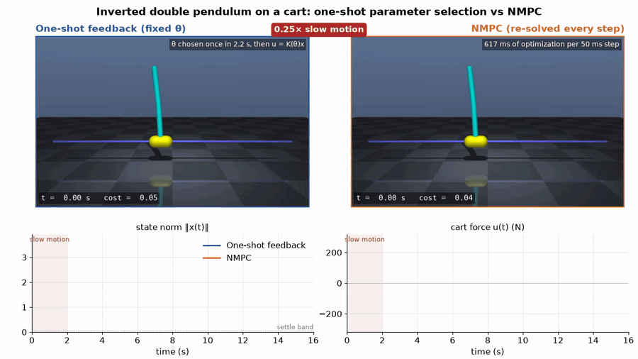

# Spectrally Consistent Feedback-Parameterized Koopman Models with Calibrated Uncertainty

<p align="center">
  
</p>
<p align="center">
  Double pendulum on a cart (MuJoCo)
  <a href="media/double_pendulum.mp4">mp4</a>
</p>

The model is a Koopman autoencoder whose encoder, operator and decoder depend on the feedback parameters theta.
We add a spectral-consistency loss so that the poles read out from the model (M = V^+ K V) match identified
linearizations, and conformal bounds on the trajectory error and on the slowest rate / damping at each theta.

## Setup

```
pip install -e .
pip install mujoco casadi   # only needed for the double pendulum and the NMPC baseline
```

Tested with Python 3.11, PyTorch 2.12, NumPy 2.4, SciPy 1.17, scikit-learn 1.9, MuJoCo 3.10, CasADi 3.7.

## Example

```python
import numpy as np
from spectral_koopman import get_system
from spectral_koopman.model import load_model, poles
from spectral_koopman.trajectory_level import load_region

arm = get_system("arm")
model = load_model("results/arm/spectral/model.pth", arm)
R = load_region("results/arm/spectral/region.npz")

th = R.sample(5, np.random.default_rng(0))
print(R.upper(th))              # bound on the trajectory error (%)
print(poles(model, th, 0.05))   # learned poles
print(arm.exact_poles(th[0]))   # true poles
```

## Layout

- `spectral_koopman/systems.py`: Van der Pol, two-link arm, cart-pole, planar quadrotor, double pendulum (mujoco)
- `model.py`: the model and the read-out
- `identification.py`: least-squares identification from short runs
- `training.py`: prediction and spectral-consistency losses
- `conformal.py`, `trajectory_level.py`, `pole_level.py`: the calibrated bounds and audits
- `protocol.py`: the whole pipeline for one system, `config.py`: settings per system
- `regressor.py`: direct regression baseline, `selection.py`, `nmpc.py`: one-shot selection and NMPC
- `scripts/`: entry points, `paper/`: tables, `results/`: trained models from the paper

## Reproducing the paper

Trained models, regions and pole labels for all models in the paper are in `results/<system>/<variant>/`.

```
python paper/make_tables.py        # table rows from paper/data
python scripts/pole_bounds.py      # pole bounds and coverage (tables 2, S3-S5)
python scripts/evaluate_poles.py   # slowest-pole errors (tables 1, S5)
python scripts/one_shot.py arm     # one-shot selection vs NMPC (tables S8, S9)
```

To train from scratch (a few hours per model on CPU):

```
python scripts/run_protocol.py vdp spectral runs/vdp/spectral
python scripts/run_protocol.py vdp no_loss runs/vdp/no_loss
python scripts/train_regressor.py vdp runs/vdp/spectral runs/vdp/regressor
```

Variants: `spectral`, `no_loss`, `exact`, `direct`, `one_step`, `noise05`, `no_loss_noise05`, `seed2`, `seed3`.
The seeds are the ones used in the paper, but results can still differ slightly between machines and library versions.

## License

MIT
